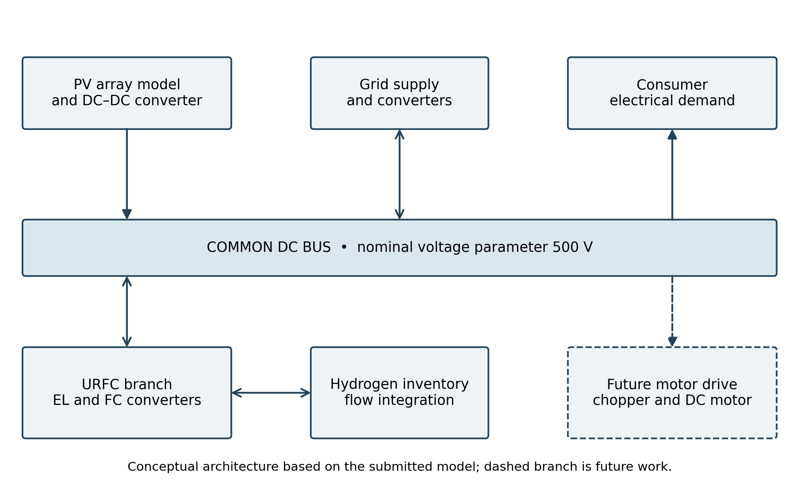
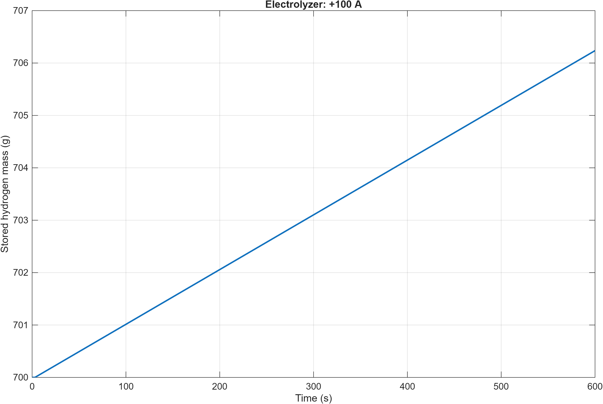
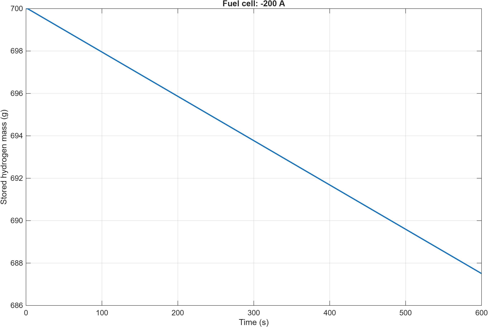
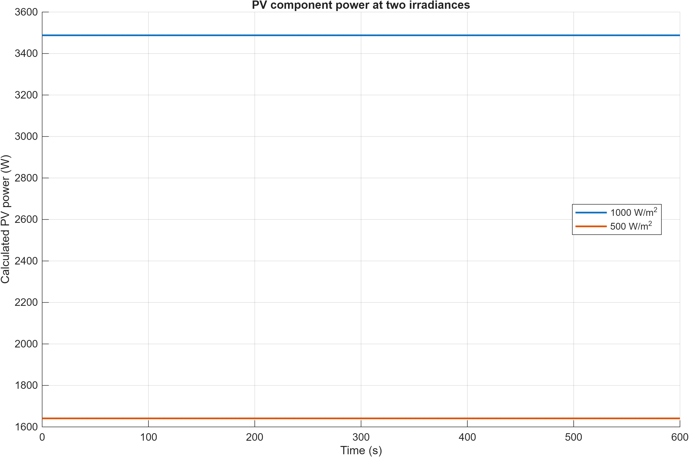
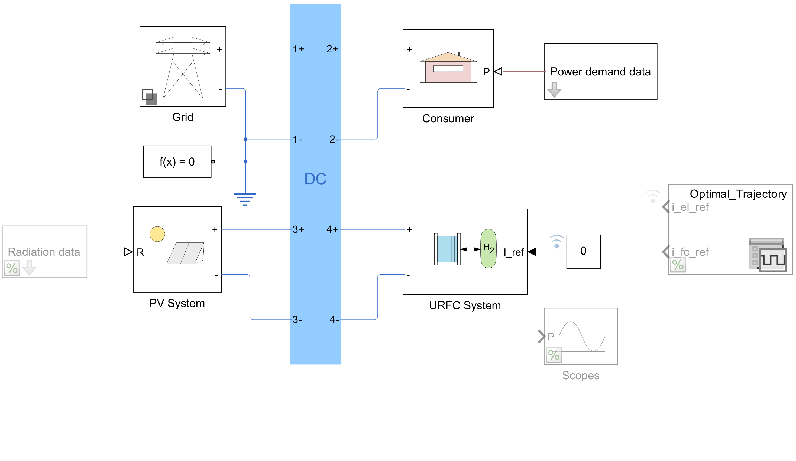
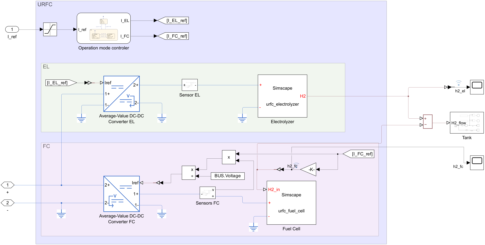

# PV–Hydrogen Energy Storage for Electric Drives

Group 25 — Drives and Modelling Lab, B.Tech. Mechatronics, MIT Manipal.

A MATLAB/Simulink study of a grid-connected photovoltaic system, unitized regenerative fuel cell (URFC), and hydrogen tank. The work investigates electrolysis, fuel-cell operation, idle behaviour, and the effect of irradiance. It forms a supply-side foundation for a future converter-fed DC motor drive.

**Status:** Five 600-second simulations were completed on the student's MATLAB R2025b installation. A motor and closed-loop speed control are future work. These results do not demonstrate autonomous operation or optimal energy management.



## Contents

| Folder | Contents |
| --- | --- |
| `simulation/` | Runnable exporter, original uploaded Simulink model, MATLAB parameters, Simscape components, input data and icons |
| `results/report_outputs_20261024_052034_911/` | Actual run: PNG and FIG graphs, subsystem diagrams, CSV signals, MAT outputs, model copy, code snapshot and diagnostics |
| `docs/` | Project report, synopsis, reproduction instructions, results discussion and SDG connection |
| `figures/` | Explanatory architecture and current plot derived from logged CSV data |

## Run in MATLAB

Requires MATLAB, Simulink, Simscape, Simscape Electrical and Stateflow; recorded run used R2025b Update 7.

1. Download and extract this repository.
2. Set MATLAB's Current Folder to `simulation`.
3. Run:

```matlab
run_report_simulations
```

The runner generates a new timestamped output directory and ZIP without overwriting `simulation/src/microgrid.slx`. See [reproduction instructions](docs/REPRODUCING.md) for expected warnings and interpretation.

## Recorded results

All cases started with 700 g of hydrogen. The grid and consumer demand remained active.

| Test | Command | Irradiance | Final tank mass | Fitted mass slope |
| --- | --- | --- | --- | --- |
| Electrolysis | +100 A | 1000 W/m² | 706.236619 g | +0.010446598 g/s |
| Fuel cell | −200 A | 1000 W/m² | 687.505869 g | −0.020893196 g/s |
| OFF | 0 A | 1000 W/m² | 700 g | approximately 0 |
| PV full irradiance | 0 A | 1000 W/m² | 700 g | approximately 0 |
| PV half irradiance | 0 A | 500 W/m² | 700 g | approximately 0 |





Calculated PV power was approximately 3487.87 W at 1000 W/m² and 1641.07 W at 500 W/m². This is component-calculated power, not measured converter delivery. See [results and limitations](docs/RESULTS.md).

## Model and circuit diagrams




The results `diagrams/` folder also contains the tank mass balance, operating-mode chart, PV subsystem, grid and consumer-load diagrams. The historical filename `Fig_3_4_PV_measurement_circuit.png` refers to the exported baseline PV subsystem after added instrumentation failed; it is not evidence of successful added sensors.

## SDG connection

This project relates to **SDG 7: Affordable and Clean Energy**, particularly Target 7.2 on increasing renewable energy's share. Solar generation with hydrogen storage provides a basis for studying renewable supply across changing solar conditions. See [SDG 7 discussion](docs/SDG7.md).

## Attribution

Adapted from [Michael Barbosa's hydrogen-energy-storage project](https://github.com/michaelfsb/hydrogen-energy-storage), upstream reference commit `41917034dadf1881c6f74708d2dfe52985ba601c`. The original MIT license and copyright notice are retained. See [provenance](docs/PROVENANCE.md).

Group 25: Syed Mohammad Naqvi, Devang Rathi and Divyansh Badola. Repository documentation and the simulation export workflow were prepared with AI assistance; simulation evidence comes from the student's uploaded MATLAB run.
